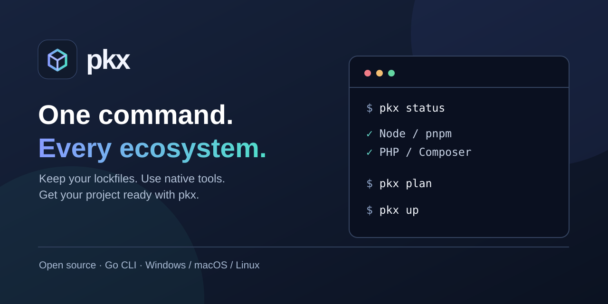
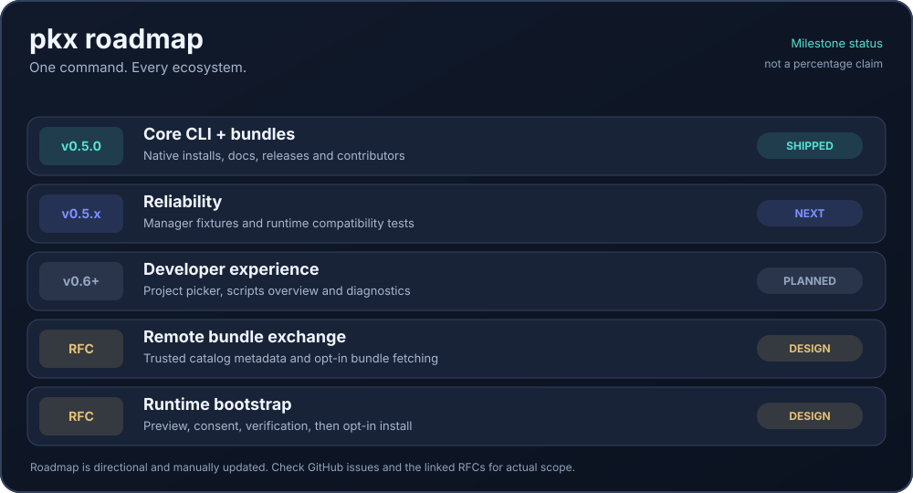

<p align="center"></p>
<h1 align="center">pkx — Package eXchange</h1>
<p align="center"><strong>One command. Every ecosystem. Your existing package managers.</strong></p>
<p align="center">
  <a href="https://github.com/AmpedWasTaken/pkx/actions/workflows/ci.yml"></a>
  <a href="LICENSE"></a>
  <a href="CONTRIBUTING.md"></a>
  <a href="https://github.com/AmpedWasTaken/pkx/issues"></a>
</p>
<p align="center">An open-source CLI for setting up mixed-language repositories.<br />No new dependency resolver. No replacement lockfiles. No required account.</p>
<p align="center"></p>

> **Version:** `v0.5.0` — first public **0.x** release candidate. The CLI is usable but its interfaces may change before v1.0. A remote bundle marketplace and automatic runtime installation do **not** exist yet.

## Development status

<p align="center">
  <a href="https://github.com/AmpedWasTaken/pkx/releases/tag/v0.5.0"></a>
  <a href="https://github.com/AmpedWasTaken/pkx/issues/12"></a>
  <a href="https://github.com/AmpedWasTaken/pkx/issues/14"></a>
</p>
<p align="center"><a href="docs/ROADMAP.md"></a></p>

**The graphic shows milestone states, not measured percentages or a release schedule.** It is updated manually as work is completed. Follow [the roadmap](docs/ROADMAP.md), [open feature issues](https://github.com/AmpedWasTaken/pkx/issues) and [the bundle marketplace](docs/rfcs/0001-bundle-registry.md) / [runtime bootstrap](docs/rfcs/0002-runtime-bootstrap.md) proposals. The marketplace and automatic runtime installation are **not implemented yet**.

## Why pkx?

A repo can have a JavaScript frontend, a PHP backend and Python scripts. Getting started often means figuring out which package manager belongs in which folder, matching runtime versions and remembering install commands. **pkx finds those projects and delegates to their native tools.**

```sh
cd your-project
pkx status  # See detected projects, lockfiles and missing tools
pkx plan    # Preview native commands; makes no changes
pkx up      # Check the environment, then install dependencies
```

`pkx up` runs native package managers with your permissions; their lifecycle scripts may execute third-party code. Review untrusted repositories and use `pkx plan` first.

## Install

**From source:** build with Go 1.23+ (works before and after the first GitHub release):

```sh
git clone https://github.com/AmpedWasTaken/pkx.git
cd pkx
go install ./cmd/pkx
pkx version
```

Make sure `$(go env GOPATH)/bin` is on `PATH`. On Windows, add the corresponding `go env GOPATH` `\bin` directory to `PATH`.

**For a published version:** download from [GitHub Releases](https://github.com/AmpedWasTaken/pkx/releases) or use the checksum-verifying [`scripts/install.sh`](scripts/install.sh) / [`scripts/install.ps1`](scripts/install.ps1) from a reviewed checkout. The installers don't elevate privileges or modify `PATH` automatically. After the v0.5.0 tag exists you can also install with `go install github.com/AmpedWasTaken/pkx/cmd/pkx@v0.5.0`. Full details: [Getting started](docs/GETTING_STARTED.md).

## Everyday commands

| Command | What it does |
| --- | --- |
| `pkx status` | Explain what's in this workspace and which tools are missing |
| `pkx plan` | Preview native install commands **without** running them |
| `pkx up` | Check the environment and install via native managers |
| `pkx doctor` | Diagnose missing/incompatible runtimes (`--json` supported) |
| `pkx scan` / `pkx ls` | Discover existing projects (`--json` supported) |
| `pkx install` / `pkx i` | Install without runtime-version preflight (`--dry-run` supported) |
| `pkx add axios` | Add packages via the detected native manager (`--dev`, `--dry-run`) |
| `pkx remove axios` / `pkx rm axios` | Remove packages through the native manager |
| `pkx run dev` | Run a declared Node/Composer script and forward optional arguments after `--` |
| `pkx plan --only node` | Preview one ecosystem/manager |
| `pkx init` | Create an empty local `pkx.json` bundle manifest |
| `pkx bundle install pkx.json --dry-run` | Preview **explicit** dependency additions |
| `pkx completion bash` | Generate shell completion (`zsh`, `fish`, `powershell` also supported) |
| `pkx help plan` | Show help for one command |

Supports npm, pnpm, Yarn, Bun, pip, uv, Poetry, Composer, Cargo and Go modules. See [exact compatibility details](docs/GETTING_STARTED.md#supported-managers-and-behavior). Existing lockfiles remain authoritative.

## Manage packages and run scripts

These commands use the project’s **existing** package manager. Supported for npm, pnpm, Yarn, Bun and Composer; they do not create a separate pkx lockfile.

```sh
pkx add axios --dry-run          # Preview first; nothing executes
pkx add axios zod                # Add dependencies
pkx add vite --dev               # Add development dependencies
pkx remove axios                 # Remove native dependencies
pkx run dev                      # Run a declared project script
pkx run dev -- --host 127.0.0.1 # Forward arguments to the script
```

With multiple matching projects, pkx **refuses to guess** where packages should go. Choose a project explicitly:

```sh
pkx add axios --project frontend
pkx run test --project backend
pkx add laravel/sanctum --project backend --manager composer
```

`--project` is relative to `--dir` (default `.`); `--manager` filters the ecosystem. `pkx run` only runs a script defined in `package.json` or `composer.json`, and suggests available scripts if its name is unknown. Add/remove for pip, Cargo and Go are not supported yet. All changes go through native package managers, which may execute untrusted installation hooks or scripts. Preview with `--dry-run` before working with unfamiliar repositories.

## Local dependency bundles

Bundles share a *list of dependencies*, not a new package format. `pkx init` creates a manifest with **no packages**. Add entries for existing project directories, preview them, and install explicitly:

```json
{
  "schema": 1,
  "name": "web-starter",
  "packages": [
    { "manager": "pnpm", "directory": "frontend", "dependencies": ["vue", "axios"], "devDependencies": ["vite"] },
    { "manager": "composer", "directory": "backend", "dependencies": ["laravel/sanctum"] }
  ]
}
```

```sh
pkx bundle install pkx.json --dry-run
pkx bundle install pkx.json
```

Directories must exist inside the workspace. Bundle installation may modify manifests and native lockfiles. There is **no hosted registry** in this preview.

## Built with contributors

pkx is MIT licensed and developed in the open. Bug fixes, tests, documentation, platform reports and new adapter proposals are welcome. You can fix a typo immediately; for larger behavior changes, start with an issue so the design stays maintainable.

- **[Contributing](CONTRIBUTING.md)** — how to set up, test and submit a PR
- **[Good first issues](https://github.com/AmpedWasTaken/pkx/issues?q=is%3Aissue+is%3Aopen+label%3A%22good+first+issue%22)** · **[All issues](https://github.com/AmpedWasTaken/pkx/issues)** — choose a task or report friction
- **[Roadmap](docs/ROADMAP.md)** · **[Architecture](docs/ARCHITECTURE.md)** — project scope and decisions
- **[Changelog](CHANGELOG.md)** · **[Release notes](docs/releases/v0.5.0.md)** · **[Release process](docs/RELEASING.md)** — versions, packages and verification
- **[Support](SUPPORT.md)** · **[Code of conduct](CODE_OF_CONDUCT.md)** · **[Security](SECURITY.md)**

If pkx helps in your own repo, **try it and open an issue with a reproducible case**. Real-world layouts and platform-specific issues are especially useful. Stars are appreciated, but good reports and PRs matter more.

## Scope and safety

pkx does **not** install system runtimes, run a daemon, collect telemetry, guarantee native installation success or automatically roll back file changes. `status` checks tool readiness rather than installed dependencies; `plan` previews commands, not their downstream effects. Cargo and Go steps download dependencies without building. Read [design principles](docs/ARCHITECTURE.md) and [security notes](SECURITY.md).

---
<sub>Maintained by <a href="https://github.com/AmpedWasTaken">AmpedWasTaken</a> with contributions welcome. MIT licensed.</sub>
